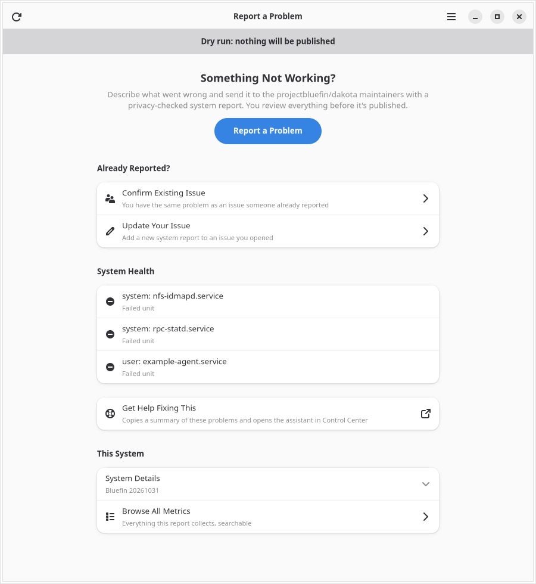
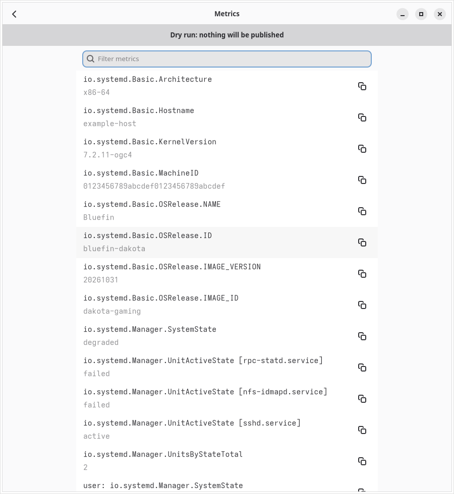
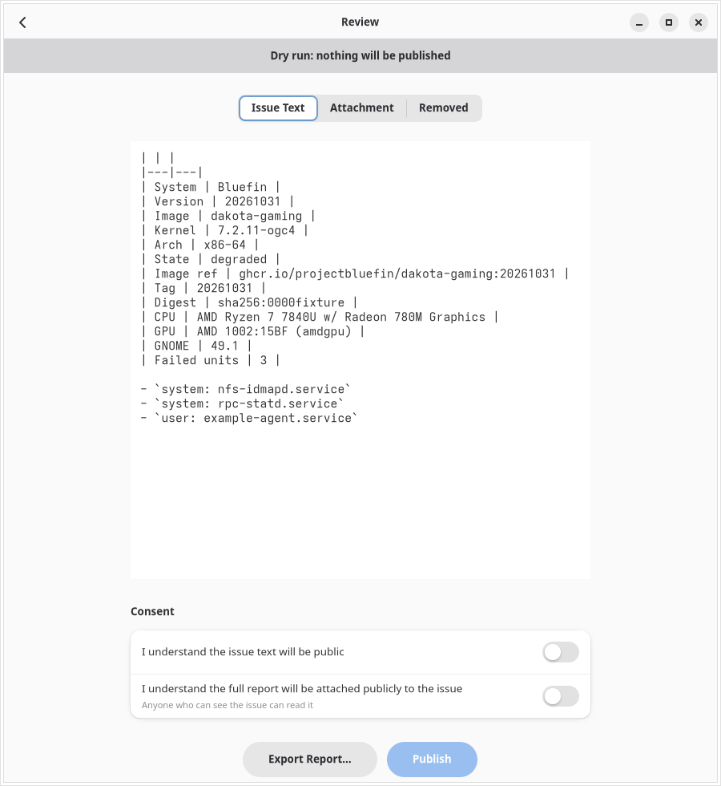

# Report a Problem (bluefin-report)

A GTK4/Libadwaita app that turns a [`systemd-report`](https://www.freedesktop.org/software/systemd/man/latest/systemd-report.html)
snapshot into a reviewed, privacy-scrubbed GitHub issue. You see exactly what
leaves the machine before anything is sent; it is published with your own `gh`
login as an issue in the right Bluefin repository, with the full report attached.

## Screenshots

  

Live captures of the application with deterministic repository fixtures—not
telemetry from a contributor's machine. Each release regenerates these views,
attaches the PNGs and provenance to the release, and opens a pull request to
refresh this gallery. The checked-in gallery updates when that PR is merged.

## Requirements

- systemd 261 or newer with `systemd-report` (Dakota ships 262, Utah 261)
- GTK 4 and libadwaita 1 (≥ 1.8, required by Keyboard Shortcuts) shared libraries from your OS
- [`gh`](https://cli.github.com/) — sign-in happens inside the app

## Install

```bash
brew install --cask projectbluefin/tap/bluefin-report
```

## Usage

```bash
bluefin-report                   # open the app
bluefin-report --dry-run         # full flow, but gh calls are logged, not run
bluefin-report --print-summary   # collect a snapshot and print the overview, no UI
```

Collection keeps system and user scopes separate: missing or malformed report
output produces a scoped warning without discarding the healthy scope. A valid
report with an empty metrics array is accepted, and numeric metric fields retain
their original JSON precision. A missing `systemd-report` executable is reported
as not installed; permission or executable-format failures stop collection.
Nonzero exits can still supply usable reports, with the failure shown as a warning.

Browse All Metrics filters the collected snapshot as you type. Each row has a
Copy button for its complete value, including text shortened on screen. An empty
search result explains how to recover; an empty collection is shown separately.

Overview leads with Report a Problem. Under Already Reported?, Confirm Existing
Issue adds your report to someone else's issue, and Update Your Issue lets the
person who opened an issue post an updated reviewed report to it, for example
after rebooting, with its own artifact and comment.
When Overview shows a problem, Get Help Fixing This copies a short summary
(image plus failed-unit and warning counts, no unit names) and runs
`chairlift --ask-bluefin`; Control Center opens its assistant or walks through its setup.

## Privacy

- Removed before you ever see it: hostname, machine ID, boot ID, machine-info,
  hardware serial numbers, system UUID and asset tags, report-signing keys,
  your username, MAC/IPv4/IPv6 addresses, email addresses, and home paths
  (`/home/<user>` → `~`). Compressed IPv6 (including IPv4-mapped addresses)
  is scrubbed even in brackets or next to sentence punctuation, and IPv4
  endpoints keep their port (`192.0.2.128:443` → `[ipv4]:443`). Whole-word
  boundaries preserve diagnostic identifiers (including Unicode), C++/Rust
  backtraces, versions and times. Pattern redaction is best-effort; the Review
  page lists every removal with a count.
- Never sent unless you opt in per entry: file contents (`io.systemd.Files.*`)
  and user-session metrics.
- Diagnostics, each off by default and not even collected unless switched on in Compose:
  errors from this boot (`journalctl -b0 -p err`, last 40 lines), crashes in the last
  7 days (`coredumpctl list`), enabled GNOME extensions, installed Flatpak apps. They are
  scrubbed like the report and attached under `extras`; errors and crashes also appear
  collapsed in the issue text. Also opt-in, unprivileged and only in the attached report:
  kernel problems in the previous boot, desktop, update/boot, network, and Flatpak/portal
  warnings from this boot's journal, and disks and graphics (`lsblk`, `nvidia-smi`, AMD sysfs).
  Network warnings also lose quoted connection names and SSIDs; extension IDs such as
  `dash-to-dock@micxgx.gmail.com` are kept although they look like email addresses.
- Always shown: image ref, tag and manifest digest, CPU model, GPUs (PCI IDs and driver),
  GNOME Shell version.
- Sent byte-for-byte as shown in Review; editing anything withdraws consent.
  An unfinished report can be retried under the same ID only with its unchanged
  reviewed draft (including its report, area, and screenshots). Resume from Drafts
  publishes that unchanged saved version; start a new report to publish edits instead.
  A draft whose files were changed on disk after Review is refused, not published.
  Unreadable or corrupt saved state is not overwritten, and the other drafts are still listed.
- The full report is attached publicly to the issue as `systemd-report.json`
  (an issue artifact): anyone who can see the issue can read it. Only if GitHub
  refuses artifacts does it fall back to a secret gist linked in an issue comment.
- Screenshots (png, jpg, jpeg, gif; up to 10, 10 MiB each) are re-encoded to strip
  metadata, but their visible content is not scrubbed and is public. They are uploaded
  to the issue as one artifact, `screenshots.md` (Confirm: `screenshots-<reportID>.md`,
  next to your report `systemd-report-<reportID>.json`). Only if GitHub refuses artifacts
  do they go in an issue comment instead. They are copied into the draft until published.
- Raw snapshots stay in memory. Drafts are kept under
  `$XDG_STATE_HOME/bluefin-report/drafts/` (mode 0700/0600): a reviewed draft keeps
  the reviewed payload; an unfinished one (saved with Ctrl+S, or automatically when
  the window closes) keeps the unreviewed title, description, steps, queue, area and
  screenshot copies, but no system report. Resume reopens an unfinished draft in
  Compose; it must be reviewed before it can be published. `--dry-run` never saves
  unfinished drafts. Discarding a
  draft can be undone from its toast; its files are deleted only when the toast
  goes away (or the window closes). It never deletes anything already on GitHub.
  The window size is kept in `$XDG_STATE_HOME/bluefin-report/window.json` (not under `--dry-run`).

## Development

```bash
make test           # go test -race ./...
make run            # build and run with --dry-run
make lint           # gofmt + go vet + go mod tidy -diff
make validate-data  # desktop-file-validate (+ appstreamcli if present)
make screenshots    # capture the running app locally; requires Xvfb/AT-SPI
make bump           # tag the next release, YY.MM.N (does not push)
make pot            # po/bluefin-report.pot translation template; needs GNU gettext ≥ 0.25
make mo data        # compile po/*.po; merge them into the desktop file and metainfo
```

Releases use calendar versions `YY.MM.N`, not a release for every commit.
The release workflow checks weekly for application changes and publishes only
after quality checks and fresh live screenshot capture succeed. It can also be
run manually in dry-run mode. `bluefin-report --version` prints the running version.

See [CONTRIBUTING.md](CONTRIBUTING.md) for release controls, screenshot runtime
requirements, and the README-refresh bot's permissions.

### Translations

The app uses GNU gettext. Wrap user-visible text in `i18n.G` (or `i18n.NG` for
counts, `i18n.N` to mark text translated later) and list the file in
`po/POTFILES`; text sent to GitHub stays in English. To add a language, run
`make pot`, create `po/<lang>.po` from the template (for example with
`msginit -l <lang> -i po/bluefin-report.pot -o po/<lang>.po`), and add `<lang>`
to `po/LINGUAS`. Releases ship the compiled catalogs in `locale/` next to the
binary; to try one locally, run `make build mo` and start
`LANGUAGE=<lang> ./build/bluefin-report --dry-run`.

Licensed under Apache-2.0.
