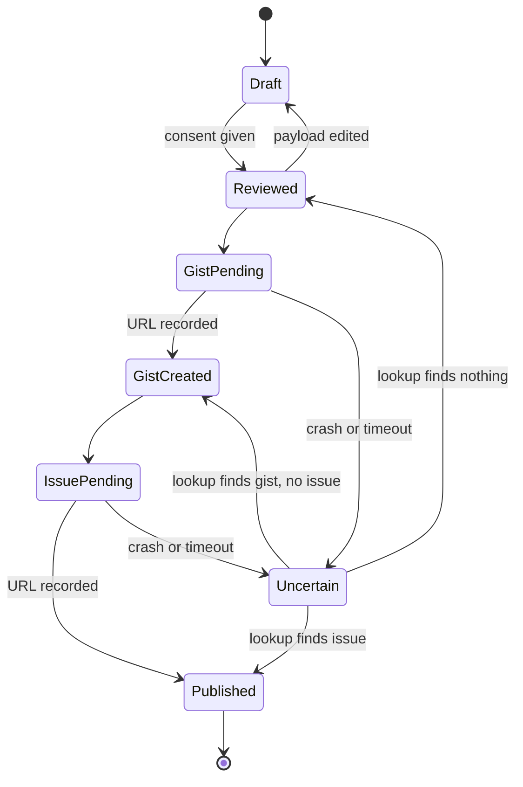

# Bluefin Report: a Libadwaita front end for `systemd-report`

Status: design, beta 2. Supersedes `systemd_report_libadwaita_design_plan.md` (beta 1).
App ID: `io.projectbluefin.Report` · binary: `bluefin-report` · repo: `projectbluefin/bluefin-report` (proposed)

## 1. What this is

A GNOME app that answers one question for a Bluefin user: **"something is wrong — what does my system say, and how do I hand that to the maintainers safely?"**

It does three things, in this order of importance:

1. **Snapshot** — collect a point-in-time report from `systemd-report` (system + user scope) and show it in a browsable, searchable form.
2. **Review** — show exactly what would leave the machine, with identifying values removed or flagged, and let the user remove anything else.
3. **Share** — file a new issue, or confirm an existing one, on the correct `projectbluefin/*` repository, with the report attached.

Snapshot and Review work fully offline and without a GitHub account. Sharing is optional.

### Non-goals (v1)

- Live monitoring, graphs, or time series. `systemd-report` metrics are counters/gauges, but this app takes snapshots; a monitoring app is a different product.
- Uploading to arbitrary HTTP endpoints via `systemd-report upload --url=` (fleet/enterprise use; needs client certs). Possible later; not a reporting flow for end users.
- Replacing Hive triage, issue templates, or Bonedigger's template sync. It does not change `ujust report`.
- Running as root or shipping polkit policy.

## 2. Verified facts the design rests on

Checked 2026-10-31 on this host (systemd 262.1) and against upstream v262 source. Bluefin ships 262; that is the only target.

| Fact | Evidence | Design consequence |
| :--- | :--- | :--- |
| Binary is `/usr/lib/systemd/systemd-report`, **not on `$PATH`**. | `command -v` fails; file exists. | Call the absolute path. |
| Verbs: `metrics`, `describe`, `generate`, `upload`, `list-sources`. | `systemd-report --help`; [man 262](https://www.freedesktop.org/software/systemd/man/262/systemd-report.html) | Use these names directly. |
| `generate [MATCH…]` emits one JSON object: `{mediaType: "application/vnd.io.systemd.report", timestamp, metrics: [...]}`. | Ran it; [report-generate.c](https://github.com/systemd/systemd/blob/v262/src/report/report-generate.c) | **Use `generate` as the single collection call.** It is the upstream report format; the attachment is that object, not a homemade dump. |
| `metrics`/`describe` with `--json` emit **JSON-SEQ** (RS `0x1e` before each object). `list-sources` emits a JSON array. | `od -c` shows `036 {`; [report.c v262](https://github.com/systemd/systemd/blob/v262/src/report/report.c) | Parser must handle RS framing. Beta 1's "`--json=short` everywhere" hides three different framings. |
| Per-source failures are **warnings with exit 0**. Here: `Unable to connect to …/io.systemd.Journal: Permission denied`, rc 0. | Ran system `describe` and `metrics`. | Exit code cannot signal completeness. Capture stderr and surface "N sources unreachable" in the UI and in the report. |
| Source code declares caps (`METRICS_MAX` 4096, 128 sources, 30 s per source; overflow warns and exits non-zero), but on this host `generate` returned **6136** system metrics with no warning. | report.c v262; `bluefin-report --print-summary` | Don't rely on the cap to bound size; bound it ourselves (§6). Still surface any non-zero exit as a warning while keeping the output. |
| No `io.systemd.Facts`. "Facts" (hostname, OS release, kernel) are string metrics under `io.systemd.Basic.*`. | Issue [#40633](https://github.com/systemd/systemd/issues/40633) closed; `describe` output. | Drop the Metrics/Facts split from the model. |
| Sources on this host — system: Basic, CGroup, Files, Journal, Manager, Network, Report.SignPlain. User: Manager only. | `list-sources` both scopes. | Profiles must declare which sources they need and degrade per source. |
| Full system `metrics` ≈ 735 KB; user ≈ 457 KB. | `wc -c` | Never paste raw output into an issue body. Budget and filter by match. |
| Raw output contains `Basic.Hostname`, `Basic.MachineID`, `Basic.BootID`, `MachineInfo.*`, SMBIOS serials/UUID/asset tags (`Basic.SMBIOS.*`), the signer's `Report.SignPlain.PublicKey`, and per-unit/per-cgroup names. | `describe` + grep | Redaction must be **by metric name** first, regex second (see §6). |
| `systemd-report-files@.service` reports `/etc/systemd/report.files/` entries **with privileged read access** to unprivileged callers. | [man devel](https://www.freedesktop.org/software/systemd/man/devel/systemd-report-files@.service.html) | `io.systemd.Files.*` is untrusted, potentially sensitive content. Excluded by default; opt-in per entry. |
| `--sign=best-effort` uses signers in `/run/systemd/report.sign/`; output becomes JSON-SEQ (report + signatures). A `SignPlain` source exists here. | man 262 `--sign` | Out of scope for v1. A plain-key signature proves nothing to GitHub readers and complicates review. Revisit with TPM signing. |
| `bootc status --format=json` (not `--json`) **requires root**. | Ran it: "must be executed as the root user". | Do not call bootc from the GUI. Image identity comes from `io.systemd.Basic.OSRelease.{IMAGE_ID,IMAGE_VERSION}` and `/usr/share/ublue-os/image-info.json` (read-only). |

Unverified: exact `describe` output for `io.systemd.Files.*`.

## 3. Users and journeys

**Primary user:** a Bluefin/Dakota/LTS desktop user who hit a problem, may not have a GitHub account, and is not a systemd expert.
**Secondary:** maintainers reading the resulting issue; contributors debugging their own machine.

### Journey A — "file a bug" (the main path)
Launch → app collects a snapshot automatically → user sees a summary ("Bluefin 43, kernel 6.x, 2 failed units, 1 source unreachable") → **Report a Problem** → title + what happened → Review → sign in if needed → Publish → issue URL.

### Journey B — "me too"
Same as A but **Confirm Existing Issue** → paste URL or `#123` → Review a short fingerprint (image, kernel, arch, failed units) → comment posted. No attachment.

### Journey C — "just look"
Launch → browse/search metrics → copy one value or export the reviewed report to a file. Never touches the network.

### Journey D — resume after failure
Publish fails or app is closed mid-publish → reopening shows the draft with its exact publication state (§7).

## 4. Interface

Beta 1 had five equal sidebar pages (Explore, Sources, Submit, Drafts, Help). That mirrors ChairLift's page count, not this workflow, and makes the primary task one of five peers. Redesign around the journey:

```
AdwApplicationWindow
└── AdwToastOverlay
    └── AdwNavigationView
        ├── Overview (root page)
        │     AdwToolbarView + AdwHeaderBar [Refresh] [menu: Drafts, Keyboard Shortcuts, About]
        │     AdwBanner (dry-run / partial snapshot)
        │     AdwPreferencesPage (clamped)
        │       Group "This system": image, version, kernel, arch, uptime   (AdwActionRow)
        │       Group "Health": failed units, unreachable sources            (AdwActionRow → detail)
        │       Group "Get help": [Report a Problem] [Confirm Existing Issue] (suggested-action pill)
        │       Group: "Browse all metrics" →                                (AdwActionRow, go-next)
        ├── Metrics (pushed)    GtkSearchBar + GtkListView (virtualized) grouped by source
        ├── Compose (pushed)    mode-specific form → [Review…]
        ├── Review (pushed)     AdwViewStack: Issue text | Attachment | What was removed
        └── Done (pushed)       AdwStatusPage: Open Issue / Copy Link
```

Decisions and reasons:

- **`AdwNavigationView`, no split view.** The content is a linear task with one browse detour. Navigation views collapse to phone width with no extra breakpoint logic and meet the HIG minimum of 360×294.
- **Review is a pushed page, not an `AdwDialog`.** It holds three tabs of editable text plus consent; HIG says secondary windows should have "limited, simple content". A page also survives window resizing and keeps Back semantics.
- **Metrics uses `GtkListView` + a `GListModel`**, not `AdwPreferencesPage`/`AdwExpanderRow`. ~4000 rows built as preference rows means 4000+ widgets and signal connections; with puregotk's fixed 2000-slot callback table (§8) that crashes. List views recycle a screenful of rows and connect handlers once in the factory.
- **Sources is not a page.** Source toggles live in Review ("Include: Network ☑ CGroup ☐ …"), where the choice matters. Unreachable sources show on Overview.
- **Drafts is a menu item**, shown on Overview as a row only when drafts exist.
- **Help is the About dialog + `F1`** opening docs. No page.
- **Errors are persistent, not toasts.** Missing `systemd-report`, too-old systemd, invalid config → `AdwStatusPage` or `AdwBanner` with an action. Toasts only confirm completed user actions ("Copied").
- **`--dry-run`** is a developer flag that replaces the GitHub client with a recorder; it shows an `AdwBanner`. Ordinary users get "Export Report…" instead, which is the honest local-only path.

### Keyboard

| Key | Action |
| :--- | :--- |
| `Ctrl+R`, `F5` | Refresh snapshot |
| `Ctrl+F` | Search (Metrics page) |
| `Alt+←`, `Esc` | Back |
| `Ctrl+Return` | Advance (Compose → Review → Publish) — Publish still requires consent switches |
| `Ctrl+S` | Save draft |
| `Ctrl+?` | Keyboard shortcuts |
| `F1` | Help |
| `Ctrl+W` / `Ctrl+Q` | Close / quit; an unpublished draft is saved first |

Every action has a visible control; every icon-only button has a tooltip and an accessible label. Status changes (collection finished, partial result) are announced via accessible properties, not only color.

## 5. Collection

One module, `internal/snapshot`, with one entry point:

```go
// Take runs `generate` and `list-sources` for both scopes. Only "systemd-report cannot run"
// is an error (ErrNotInstalled); unreachable sources, non-zero exits and unreadable scopes are Warnings.
func Take(ctx context.Context, run Exec, matches []string) (Snapshot, error)

// Describe is separate: only the Metrics page needs it.
func Describe(ctx context.Context, run Exec, scope Scope) (map[string]Family, []string, error)

type Snapshot struct {
    TakenAt  time.Time
    System   Report   // parsed generate output, system scope
    User     Report   // parsed generate output, user scope
    Sources  []Source // list-sources, both scopes, with Scope field
    Warnings []string // stderr lines and non-zero exits, prefixed with scope and verb
}
```

Rules:

- Calls: `generate --json=short [MATCH…]` and `list-sources --json=short` per scope; `describe --json=short` per scope on demand (cache per session). All with `--no-pager --no-legend`, `exec.CommandContext`, stdout capped at 8 MiB and stderr captured. `Exec` is the one seam: tests pass a fake, the app passes `snapshot.Run`.
- **System and user reports stay separate objects.** Same metric names exist in both scopes (`io.systemd.Manager.*`); merging loses provenance.
- A snapshot is **immutable** once taken. Refresh produces a new snapshot; a late result from a cancelled refresh is discarded by generation number.
- Profiles are named match lists, defined in one Go file, each listing the sources it needs:

| Profile | Matches | Needs |
| :--- | :--- | :--- |
| Baseline (always) | `io.systemd.Basic`, `io.systemd.Manager` (failed/unit state families) | Basic, Manager |
| Network | `io.systemd.Network` | Network |
| Resources | `io.systemd.CGroup` | CGroup |
| Logs | `io.systemd.Journal` | Journal (often permission-denied for users) |

Beta 1's "Sleep/Crash", "Bootc/Update" and "Flatpak" profiles are **removed**: no source on this host provides that data. Add them when a source exists, not before. A profile whose sources are missing is shown disabled with the reason; it is never shown as "nothing found".

## 6. Privacy

Principle: **nothing leaves the machine that the user has not seen in its final form, and the app removes known identifiers before the user ever sees them.**

1. **Drop by name** (deterministic, primary): `io.systemd.Basic.{Hostname,MachineID,BootID}`, `io.systemd.Basic.MachineInfo.*`, SMBIOS `SystemSerialNumber`, `SystemUUID`, `BaseBoardSerial`, `ChassisSerialNumber`, `BaseBoardAssetTag`, `ChassisAssetTagNumber` (make, model and firmware stay: they're diagnostic), `io.systemd.Report.*` (signer public keys link reports to one machine), and `io.systemd.Files.*` (unless opted in per entry).
2. **Redact by pattern** (secondary, on remaining string values and on `object`/`fields` labels): MAC, IPv4/IPv6, email, `/home/<user>` and `/var/home/<user>` → `~`, the current username and hostname as literal strings wherever they appear.
3. **Show the result.** Review tab "What was removed" lists each rule with a count and lets the user expand to see the original values *locally*.
4. **Edits invalidate consent.** Any change to included sources or text after consent unchecks the switches.
5. **Freeze the payload.** Publish sends the bytes shown in Review, byte-for-byte; no re-collection or re-formatting after consent.
6. **Size budgets keep valid JSON.** Attachment ≤ 1 MiB; if over, drop whole metric families (largest first), record them in `"omittedFamilies"`, never cut mid-object. Issue body ≤ 60 KB (GitHub limit is 65,536 chars).
7. **Storage.** Raw snapshots live in memory only. Drafts store only the reviewed payload, in `$XDG_STATE_HOME/bluefin-report/drafts/<id>/`, mode `0700`/`0600`, written via temp file + rename.
8. Deleting a local draft never implies deleting anything remote; the UI says so when a gist/issue already exists.

Regex redaction is best-effort and the UI says so in one line, not a paragraph.

## 7. Sharing to GitHub

### Routing
Read `IMAGE_ID` from the Basic OS-release metrics. A machine reports only to the repo of the image it runs:

| Image | Repo |
| :--- | :--- |
| `dakota`, `dakota-*` | `projectbluefin/dakota` |
| `utah`, `utah-*` | `projectbluefin/utah` |
| anything else | none: Report a Problem and Confirm Existing Issue are disabled, with the reason shown |

The repo is shown, not chosen. `publish.Submit` accepts only these two repos and rejects anything else before any network call. One check, one place.

### Transport
Use `gh` (Homebrew) rather than a token store of our own. Beta 1 corrections:

- Sign-in: run `gh auth login --hostname github.com --git-protocol https --web --skip-ssh-key` without a TTY; read the one-time code from stderr, show it in an `AdwAlertDialog` with Copy, and open the URL with `GtkUriLauncher`. (Beta 1 said "8-character code" — it is `XXXX-XXXX`.) Verify exact non-TTY output against the pinned `gh` version before building on it.
- Attachment: **secret gist** (default `gh gist create`, no `--public`). Anyone with the link can read it, which the consent text states plainly; it is not listed on the user's profile.
- Triage preference: **do not pass `--label`.** Reporters usually lack triage permission on the target repo, so label writes can fail the whole create. Put `<!-- hive-queue: 3-clanker-queue -->` in the body and let Hive apply labels. Confirm marker name with the Hive owners.
- Issue URL comes from `gh issue create` stdout.

### Publication is not atomic — model it

States are persisted in `draft/<id>/state.json` before each network step:



- Each draft carries a random `report-id` written into the gist description and an HTML comment in the issue body.
- **Uncertain** is resolved by lookup, not by retrying: search the user's recent gists and `is:issue author:@me <report-id>` on the target repo. Only if nothing is found does the app return to Reviewed.
- Confirm mode is one step (`gh issue comment`) with the same Uncertain handling.

## 8. Stack and packaging

Match ChairLift where it is load-bearing, and only there.

- **Go**, `CGO_ENABLED=0`, toolchain pinned to ChairLift's (`go 1.26.x` per its `go.mod`). Beta 1 said 1.23+.
- **Bindings:** `codeberg.org/puregotk/puregotk/v4/{gtk,adw,gio,glib,gobject}`. Beta 1's `github.com/jwijenbergh/puregotk` path is wrong.
- **Threading:** `github.com/frostyard/snowkit/gtk.RunOnMainThread`. That and `gobj`/`toast.Notifier` are all snowkit provides — it has no preference-group builders or YAML validation (beta 1 claimed both).
- **Callback discipline:** puregotk caches callbacks in a fixed 2000-slot table that is never freed. Connect every signal once at build time; row actions go through list-item factories and a static router. This is why §4 uses `GtkListView`.
- **Runtime requirements:** host `libgtk-4.so.1`, `libadwaita-1.so.0` (≥ 1.6 for `AdwBreakpoint`/current dialogs), systemd 262. "Cgo-free" does not mean self-contained.
- **Configuration:** none in v1. Beta 1's YAML file toggled UI groups and carried a `blocked_org_prefixes` list; both are config for values that do not change. The org allow-list is a constant. Add `/etc/bluefin-report/config.yml` when an image actually needs to hide something.
- **GSettings:** only window size and last-used profile. If nothing else needs it, use a small state file instead and skip schema install entirely.
- **Distribution:** Linux cask `Casks/bluefin-report.rb` in `projectbluefin/homebrew-tap`, following `chairlift.rb`: `arch arm: "arm64", intel: "amd64"`, `depends_on :linux`, desktop file and icons installed to `~/.local/share` in `postflight`, removed on uninstall, launcher wrapper that runs `brew shellenv` so `gh` is found. Bumps arrive via the tap's existing `mergeraptor` autobump + automerge.
- Repo ownership: ChairLift lives at `projectbluefin/chairlift` (beta 1 mixed in `frostyard`).

## 9. Package layout

```
cmd/bluefin-report/main.go      flags: --dry-run, --resume=<id>, --confirm=<url>
internal/snapshot/              Take(), parsing of generate/describe/list-sources, JSON-SEQ reader
internal/privacy/               Redact(Snapshot, Choices) → Payload + Removed[]
internal/publish/               routing, gh client, draft state machine
internal/ui/                    window, overview, metrics, compose, review, done
data/                           .desktop, .metainfo.xml, icons
testdata/                       recorded v262 outputs (both scopes, with a permission-denied stderr)
```

Three domain packages, each one deep entry point, each testable without GTK. No `templates/` (Bonedigger owns issue forms), no config package, no `sync-templates.yml`.

## 10. Delivery slices

Each slice is shippable and demoable.

| # | Slice | Done when |
| :--- | :--- | :--- |
| 1 | **Snapshot core** — ✅ done | `go test -race ./internal/snapshot` passes on fixtures modeled on real v262 output (identifiers replaced): JSON-SEQ `describe`, permission-denied warning with rc 0, non-zero exit keeps output, broken user scope doesn't lose system, missing binary. `go run ./cmd/bluefin-report --print-summary` on this host: Bluefin 20261031 (dakota-gaming), 6136 system / 3431 user metrics, 8 sources, 2 failed units, Journal unreachable. |
| 2 | **Privacy** — ✅ done | `go test -race ./internal/privacy`: hostname (incl. systemd `\x2d`-escaped form in unit names), machine/boot ID, machine-info, username, IPv4/IPv6, MAC, email and home paths removed; `getty@tty1.service`-style template units kept; `io.systemd.Files.*` and user scope opt-in; budget omits whole families largest-first and stays valid JSON. Real host, both scopes: no hostname/machine-id/boot-id/username in output; 893 KB after omitting `ActiveTimestamp` and `InactiveExitTimestamp`. |
| 3 | **Overview + Metrics UI** — ✅ done | Driven via AT-SPI (final pass in an isolated headless mutter session): overview loads in ~150 ms, failed units and unreachable sources shown, Metrics name+value rows searchable over ~9,500 metrics and readable at 360×294, missing-binary status page (`BLUEFIN_REPORT_SYSTEMD_REPORT=/nonexistent`), Keyboard Shortcuts dialog, Ctrl+R/F5/Ctrl+F/Ctrl+?/F1/Ctrl+Return/Ctrl+W/Ctrl+Q. One `glib.SourceFunc` for all main-thread work (puregotk's 2000-callback table), tested with 5000 posts. |
| 4 | **Compose + Review + Export** — ✅ done | Driven: Review gated on title or a valid same-repo issue link, Export/Publish reachable at 360×294, attachment has no hostname/username/machine-id, editing issue text clears both consents, Confirm has no attachment, exported file (0600) byte-size equals the reviewed payload. |
| 5 | **Publish** — ✅ done (no real publish yet) | `go test -race ./internal/publish`: REST lookups (not search) for gist/issue/comment, any failure → Uncertain, retry/resume by report ID never duplicates, issue refs validated and passed after `--`, signed-out resume → sign-in. Driven against a fake `gh`: device-code sign-in parsed from real `gh` output, failure → Drafts → relaunch → Resume (one more issue create, no second gist), Discard. **Open:** a real publish to a sandbox repo by a human. |
| 6 | **Packaging** — 🟡 in review | v0.1.0 released by goreleaser (amd64/arm64); cask install/uninstall verified from a local tap; CI validates desktop file and metainfo. Waiting on homebrew-tap#40 and .project#31. |

Bonedigger and `ujust report` are unchanged.

## 11. Open decisions

1. App name and ID — `Bluefin Report` / `io.projectbluefin.Report` proposed; beta 1's `systemd-report-gui` reads as an upstream systemd project.
2. Hive marker format for queue preference — needs the Hive owner's answer.
3. Whether to attach user-scope report by default (it names user units; less sensitive than system, still personal).
